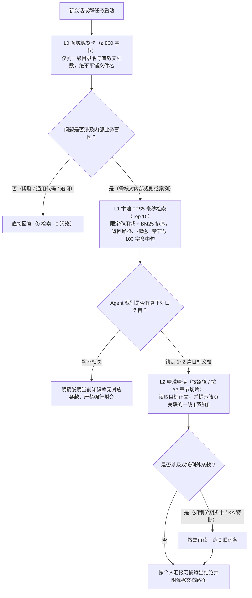

# 知识库与 LLM Wiki 接入设计方案（防污染 · 万级规模 · 零额外费用版）

本文档基于 `AgentCrew` 现有多 Agent 运行时适配（`src-tauri/src/providers.rs`）、群聊上下文组装（`src-tauri/src/collaboration.rs`、`src-tauri/src/group_context.rs`）及 SQLite 存储架构（`001_*.sql` ~ `026_*.sql`），给出接入本地 **LLM Wiki / 本地 Markdown 业务知识库** 的完整产品与技术实现设计。

---

## 1. 核心架构原则

1. **职责清晰分工（不重复造重型解析轮子）**
   - **LLM Wiki**（本机 `127.0.0.1:19828`）：负责吞吐 PDF / Word / 网页等外部原始资料，编译并维护结构化的本地 Markdown 双链百科（`wiki/**/*.md`）。
   - **AgentCrew**：负责**「常驻个人习惯记忆 + 按业务群/会话挂载作用域 + L0/L1/L2 渐进式按需检索 + 对话结论受控回流沉淀」**。
2. **根治上下文污染（改「后端每轮盲塞」为「渐进式披露 + Agent 按需拉取」）**
   - 废除传统 RAG 每发一句话就由后端硬塞 Top-3 片段的做法；
   - 会话启动仅注入极简的 **个人通用习惯** 与 **L0 领域概览卡**；日常寒暄、格式调整、通用代码修复与同话题追问保持 **0 检索、0 业务正文注入**；仅当触及内部业务盲区时，由具备工具能力的 Agent 主动按需拉取摘要与目标章节。
3. **支撑万级文件规模（50,000+ 文件毫秒响应）**
   - 禁止在发消息时实时递归遍历磁盘（`fs::read_dir`），禁止前端全量拉取文件列表；
   - 内置 **Rust 后台异步增量索引器 + SQLite `FTS5`（BM25 相关性排序）**，支持按目录前缀过滤与按 Markdown `## ` 章节切分精读，5 万+ 文档检索耗时 `< 10ms`。
4. **全程 0 额外 API 费用**
   - 本地全文索引与 BM25 检索 100% 运行在本机 CPU，无需购买云端向量数据库或 Embedding API；
   - 访问 `LLM Wiki` 仅调用纯本机文件/图谱读取接口（`/api/v1/health`、`/projects`、`/files`、`/graph`），**严禁调用会触发外部大模型扣费的 `/chat` 接口**；且支持离线直接只读本地目录兜底；
   - 沉淀整理笔记可直接复用 `AgentCrew` 内已登录订阅的 Codex / Claude Code / Gemini，零额外支出。

---

## 2. 大模型何时需要知识库？（触发边界与防污染机制）

### 2.1 六类对话场景的介入策略

| 对话场景 | 典型示例 | 知识库介入策略 | 上下文增量 |
| :--- | :--- | :--- | :--- |
| **日常推进 / 排版微调** | “你好”、“把第二段改成表格”、“语气再正式点” | **零介入**（不检索、不塞任何业务正文） | `0 B` |
| **纯代码 / 通用技术任务** | “修一下这个 TS 类型报错”、“写个排序函数” | **零介入**（代码项目默认不挂载任何业务库） | `0 B` |
| **同话题第 2～N 轮追问** | 围绕第 1 轮已读过的《返点规则》继续细化方案 | **零重复注入**（直接复用当前会话已读取内容） | `0 B` |
| **新会话 / 群任务初始化** | 新建私聊会话或群聊需求会话 | 仅注入 **精炼个人通用习惯** + 当前绑定库的 **L0 一级领域概览卡** | `≤ 2 KB` |
| **触及内部业务盲区** | 内部黑话、SOP 审批口径、定价/返点公式、历史特例 | **Agent 按需下钻拉取**：L1 搜 Top-10 标题摘要 ➔ 甄别真相关项 ➔ L2 精读 1～2 篇（或对应章节） | 按需 `1~6 KB` |
| **用户显式 `@笔记` 点名** | 输入框手动搜索并挂载某篇业务文档胶囊 | **确定性直传**：本轮精准带入指定笔记正文，不漫无目的乱搜 | 按实际点名篇幅 |

### 2.2 四道防污染与防串味隔离墙

1. **会话作用域硬隔离（防跨业务串味）**
   - 代码仓库会话默认不挂业务知识库；A 业务群仅绑定 A 业务空间（或指定一级子目录），物理不可见 B 业务文档。
   - 全局常驻「个人习惯」严格限定为跨业务通用的沟通/排版偏好（预算上限 `1.8 KB`），严禁混入具体业务政策。
2. **正式有效页与历史废弃页隔离（防新旧口径打架）**
   - 索引器解析 YAML Frontmatter 与标签：默认检索仅返回 `wiki/` 正式有效页，自动跳过 `raw/` 未整理草稿，并排除带有 `status: deprecated`、`#已废弃`、`#归档` 标记的历史旧规。
3. **`display_text` 与 `runtime_prompt` 分离（防界面气泡污染）**
   - 写入 `codex_messages` 表供前端渲染的始终是干净的用户输入原文；仅在发往底层 CLI / SDK 运行时时附加上下文片段。
   - 私聊会话在 `conversation_wiki_bindings.last_injected_hash` 记录已注入的习惯与 L0 概览版本，同一原厂会话（Session Resume）只注入首轮一次，杜绝多轮滚雪球膨胀。
4. **资料「二八分层」（防万级档案拖垮 Wiki 编译）**
   - **精编核心规则层（`core_wiki`，百～千级）**：现行 SOP、定价政策、黑话词典、个人习惯，维护高质量 `[[双链]]`。
   - **海量历史档案层（`archive`，万级）**：往年工单、合同、会议纪要，原样存放在本地目录仅建 `FTS5` 索引，不送入 `LLM Wiki` 逐篇调大模型重编。

---

## 3. L0 ➔ L1 ➔ L2 三级漏斗下钻检索流程



---

## 4. 数据库增量迁移设计（`027_knowledge_wiki.sql`）

计划新增迁移脚本 `src-tauri/migrations/027_knowledge_wiki.sql`：

```sql
-- 1. 全局连接与上下文预算配置（单行表 id = 1）
CREATE TABLE IF NOT EXISTS wiki_settings (
    id INTEGER PRIMARY KEY CHECK (id = 1),
    enabled INTEGER NOT NULL DEFAULT 1,
    base_url TEXT NOT NULL DEFAULT 'http://127.0.0.1:19828',
    api_token TEXT NOT NULL DEFAULT '',
    habits_budget_bytes INTEGER NOT NULL DEFAULT 1800,
    l0_map_budget_bytes INTEGER NOT NULL DEFAULT 800,
    read_budget_bytes INTEGER NOT NULL DEFAULT 6000,
    updated_at TEXT NOT NULL DEFAULT (strftime('%Y-%m-%dT%H:%M:%fZ', 'now'))
);
INSERT OR IGNORE INTO wiki_settings (id) VALUES (1);

-- 2. 知识源注册表（兼容 LLM Wiki 项目与本地 Markdown 大目录）
CREATE TABLE IF NOT EXISTS wiki_sources (
    id TEXT PRIMARY KEY,
    name TEXT NOT NULL,
    source_kind TEXT NOT NULL DEFAULT 'llm_wiki',        -- 'llm_wiki' | 'local_folder'
    tier TEXT NOT NULL DEFAULT 'core_wiki',              -- 'core_wiki' | 'archive'
    root_path TEXT NOT NULL,
    content_subdir TEXT NOT NULL DEFAULT 'wiki',
    inbox_subdir TEXT NOT NULL DEFAULT '00-inbox',
    doc_count INTEGER NOT NULL DEFAULT 0,
    index_state TEXT NOT NULL DEFAULT 'idle',            -- 'idle' | 'indexing' | 'ready' | 'error'
    last_indexed_at TEXT
);

-- 3. 全局常驻「个人通用习惯」勾选页
CREATE TABLE IF NOT EXISTS wiki_habit_pages (
    source_id TEXT NOT NULL,
    rel_path TEXT NOT NULL,
    title TEXT NOT NULL,
    enabled INTEGER NOT NULL DEFAULT 1,
    sort_order INTEGER NOT NULL DEFAULT 0,
    PRIMARY KEY (source_id, rel_path)
);

-- 4. 文档元数据与增量同步游标表（基于 mtime_ms + size_bytes 毫秒比对）
CREATE TABLE IF NOT EXISTS wiki_documents (
    id INTEGER PRIMARY KEY AUTOINCREMENT,
    source_id TEXT NOT NULL,
    rel_path TEXT NOT NULL,
    top_domain TEXT NOT NULL DEFAULT '',
    title TEXT NOT NULL,
    tags TEXT NOT NULL DEFAULT '',
    is_deprecated INTEGER NOT NULL DEFAULT 0,
    mtime_ms INTEGER NOT NULL,
    size_bytes INTEGER NOT NULL,
    UNIQUE (source_id, rel_path)
);
CREATE INDEX IF NOT EXISTS idx_wiki_docs_domain ON wiki_documents(source_id, is_deprecated, top_domain);

-- 5. 章节级 FTS5 全文倒排索引表（BM25 相关性排序）
CREATE VIRTUAL TABLE IF NOT EXISTS wiki_sections_fts USING fts5(
    source_id UNINDEXED,
    rel_path UNINDEXED,
    section_heading,
    body,
    tokenize = 'unicode61'
);

-- 6. 双链关系边表（支撑一跳 [[关联规则]] 提示与跳转）
CREATE TABLE IF NOT EXISTS wiki_links (
    source_id TEXT NOT NULL,
    from_path TEXT NOT NULL,
    to_target TEXT NOT NULL,
    PRIMARY KEY (source_id, from_path, to_target)
);

-- 7. 会话 / 群聊作用域绑定表
CREATE TABLE IF NOT EXISTS conversation_wiki_bindings (
    conversation_id TEXT PRIMARY KEY,
    source_id TEXT NOT NULL,
    domain_filter TEXT,
    include_archives INTEGER NOT NULL DEFAULT 0,
    last_injected_hash TEXT
);
```

---

## 5. 前后端模块与代码改动触点

### 5.1 Rust 后端（`src-tauri/src/`）
- **新增 `src-tauri/src/wiki.rs`**（并在 `lib.rs` 注册）：
  - **LLM Wiki 本地客户端**：对接 `GET /api/v1/health`、`GET /api/v1/projects`、`GET /api/v1/projects/{id}/files`、`GET /api/v1/projects/{id}/graph`（支持 `Authorization: Bearer <token>`）；未运行 `LLM Wiki` 时无缝回退至磁盘 `root_path` 只读访问。
  - **后台异步增量 `FTS5` 索引器**：按 `mtime_ms` 与 `size_bytes` 增量扫描 `.md`/`.txt`，按 `## ` 切分章节、识别 `status: deprecated` / `#已废弃` 标签并提取 `[[wikilinks]]`。
  - **本机回环只读检索端点**（复用 `pairing.rs` 的 `127.0.0.1` 回环 HTTP 服务 + 会话级只读短令牌）：
    - `GET /local-wiki/search?q=...&domain=...`：返回 Top-10 命中标题、路径、章节与 100 字摘要；
    - `GET /local-wiki/read?path=...&section=...`：返回对应正式页或章节正文，并列出该页关联的一跳 `[[双链]]` 词条名。
    - 跨 Codex、Claude Code、Gemini、DeepSeek 四大运行时零配置通用，且物理保证 100% 只读。
  - **受控沉淀归档 `wiki_archive_note`**：将确认后的结论写入 `00-inbox/`（或 `raw/sources/`，若 `LLM Wiki` 在线可选调用 `POST /api/v1/projects/{id}/sources/rescan`）。
- **改造 `providers.rs` 及 `codex.rs` / `claude.rs` / `gemini.rs` / `deepseek.rs`**：
  - `send` / `send_recorded` 支持传入 `extra_context: Option<&str>`，`codex_messages` 仅存用户展示文本 `text`，底层发送拼接 `extra_context`。
- **改造 `agent_commands.rs`、`collaboration.rs`（及可选 `schedules.rs`）**：
  - 私聊首轮按 Hash 注入个人习惯 + 绑定库的 L0 领域卡；
  - 群聊在 `collaboration.rs` 组装 `sections` 时按预算拼入习惯、L0 领域卡及用户本轮显式点名的笔记。

### 5.2 React 前端（`src/`）
- **`src/features/chats/SettingsDialog.tsx`**：`SettingsTab` 扩展 `"wiki"` 页签，管理 `LLM Wiki` 本地连接（`http://127.0.0.1:19828` + Token 测试同步）、本地目录接入、索引进度展示及「全局常驻个人习惯」勾选（带字节预算进度条）。
- **`src/features/chats/GroupDialog.tsx`**：在「关联项目」下方并列增加「关联业务知识库（可选）」，支持代码目录与业务 Wiki 同时挂载。
- **`src/features/chats/ChatStage.tsx`**：输入框工具栏增加轻量知识库入口（后端分页检索，单次最多返回 30 条，支持点选生成引用胶囊）；点击消息中的知识库引用路径复用 `local_files.rs` 直接打开本地原文件核对。
- **`src/features/chats/TaskResults.tsx` / 消息操作栏**：增加「沉淀到知识库」按钮，安全写入 `00-inbox/`（整理模式下配合 `git.rs` 提供可视化 Diff 与一键回滚）。

---

## 6. 分阶段开发计划

| 阶段 | 交付内容 | 里程碑验收目标 |
| :--- | :--- | :--- |
| **Phase 1：检索引擎与防污染底座** | `027_knowledge_wiki.sql` + `wiki.rs` 增量 `FTS5` 索引器 + 回环只读 `/local-wiki/search` & `/read` + 展示气泡与运行时 Prompt 分离 + 首轮习惯与 L0 概览卡注入 | 闲聊/纯代码 0 检索不污染；问内部业务时 Agent 主动毫秒检索并准确顺藤摸瓜读取双链特例 |
| **Phase 2：可视化配置、群隔离与点名** | 设置页「知识库」Tab + 群设置业务库绑定 + 聊天输入框后端分页搜索与手动点名胶囊 | 多业务群物理隔离不串味；支持万级文件下毫秒搜索点名引用 |
| **Phase 3：受控回流沉淀闭环** | AI 回复与任务结果一键写入 `00-inbox/`（可选触发 `LLM Wiki` `/sources/rescan`）+ 整理模式 Git 快照回滚 | 打通「聊业务 ➔ 0 额外成本安全沉淀 ➔ 增量索引即时生效」完整闭环 |

---

## 7. 本地联调测试数据集与验收用例

本机已预置一套符合 `LLM Wiki` 标准结构的模拟品牌电商业务库（`../mock-business-wiki`，即 `/Users/nangua/Documents/AgentCrew/mock-business-wiki`），包含 16 篇正式页、52 条闭合双链、2 份 `raw/sources/` 原始纪要及 1 篇标记 `status: deprecated` 的废弃旧规对照组。

后续开发完成后，可直接用以下 4 道用例验收：

1. **内部黑话 + 售后边界核验**
   - 提问：*“有个 VIP2 客户买的加湿器外箱破损了，下午 4 点推单能从绿灯仓走飞鹰补发当天发出吗？”*
   - 预期结论：**不可行**。虽满足嘉兴绿灯仓 `16:30` 截单及吊牌价 `¥1,099.00 ≤ ¥1,200.00`，但「飞鹰补发」要求零售客户等级 **≥ VIP3**。
2. **一跳 `[[双链]]` 例外追踪 + 废弃旧规防污染 + 个人算式习惯**
   - 提问：*“金牌经销商在双 11 S2 锁价期提货 60 万，能拿多少返点？”*
   - 预期结论：顺着 `channel-rebate-policy-2026` 的双链读到 `s2-price-lock-exception` 折半规则，按两位小数算式输出 `6.50% × 50% = 3.25%`，`¥600,000.00 × 3.25% = ¥19,500.00`（不得漏看双链答 `6.50%`，更不得被已废弃的 2024 旧规 `8.00%` 污染）。
3. **实体档案 + 红线双签审批流**
   - 提问：*“华辰集团想把 Q4 备货账期延到 60 天，林岚可以直接批吗？”*
   - 预期结论：**不可行，需走特批**。华辰标准账期 `30 天`，申请 `> 45 天` 须由 **财务负责人陈默 + 法务组** 双签。
4. **无关问题零污染检验**
   - 提问：*“帮我用 TypeScript 写一个防抖函数”*
   - 预期结论：0 知识库检索调用，直接输出干净代码，不强行套用四段式业务汇报结构。
